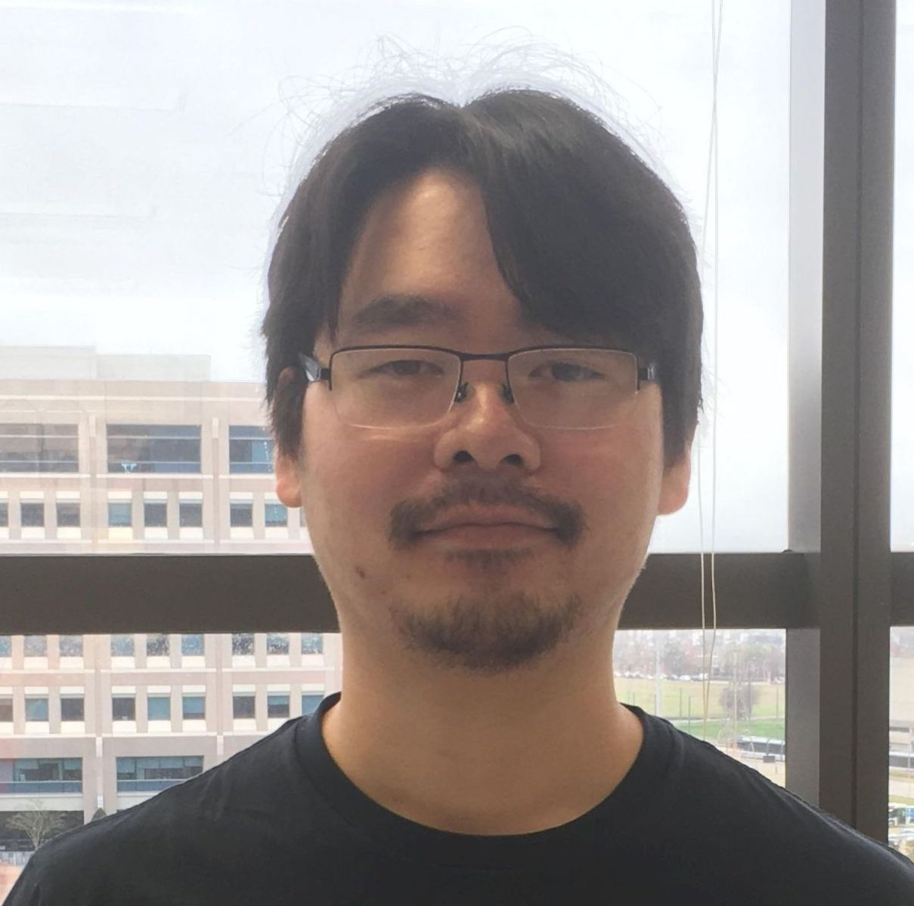
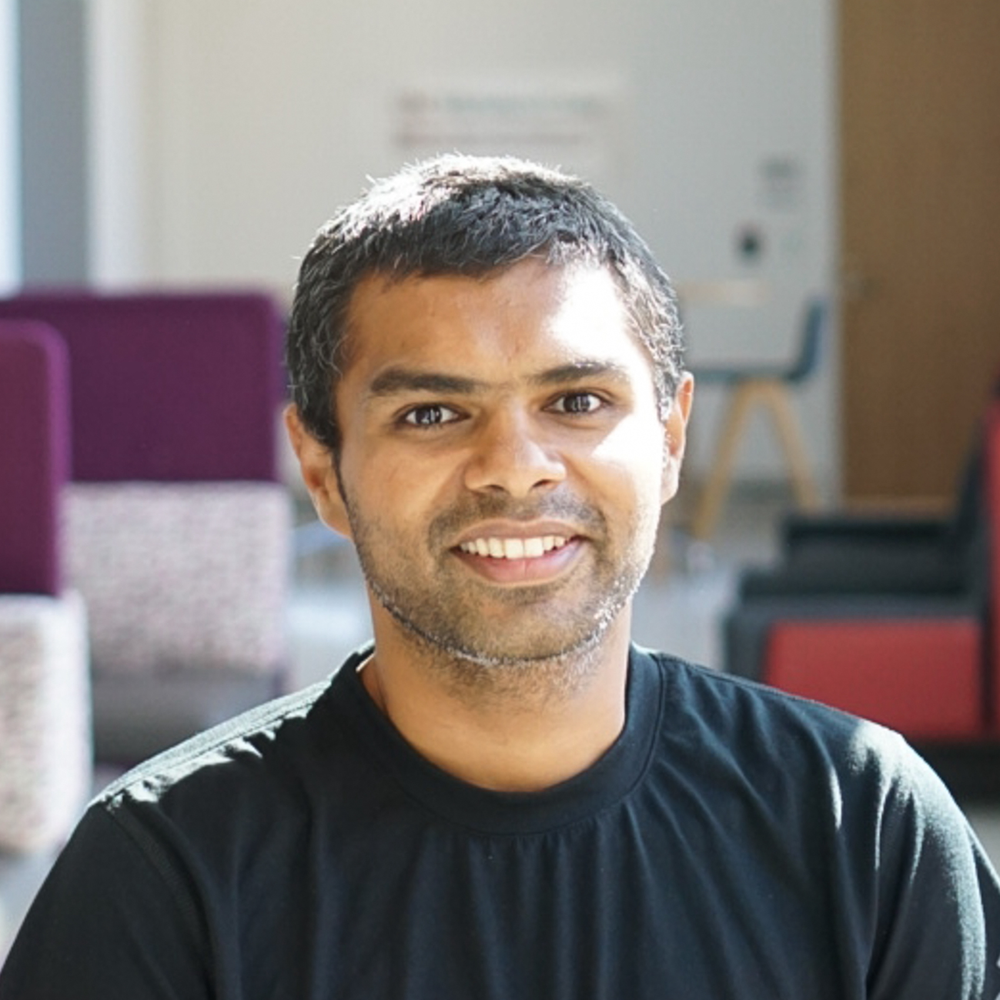
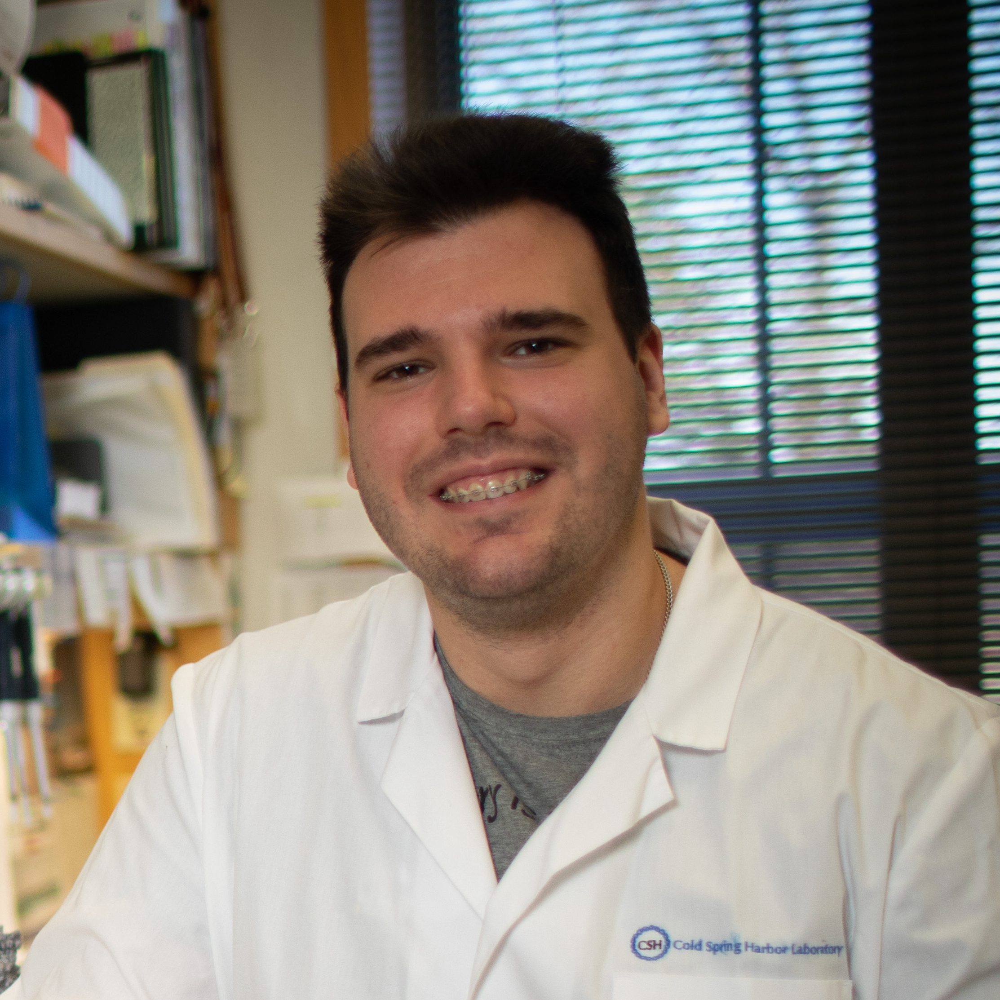
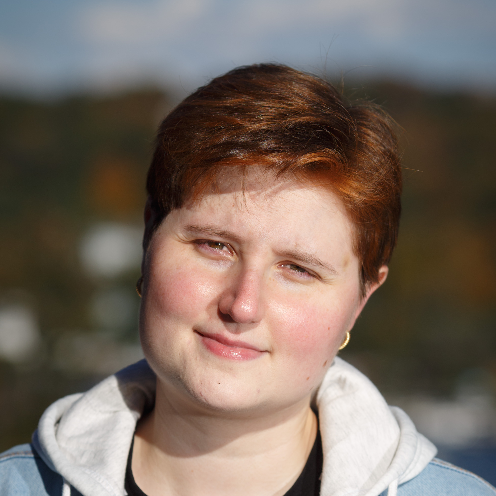
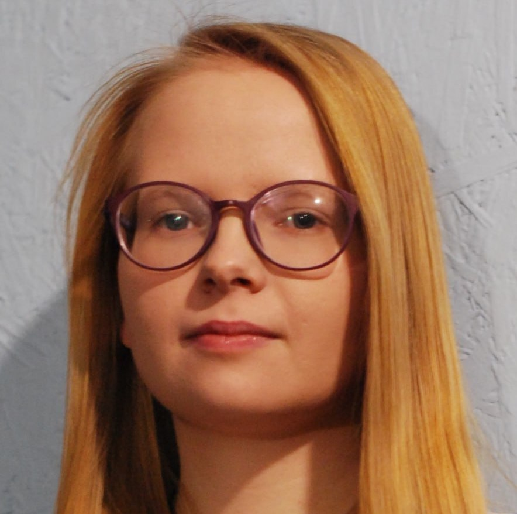
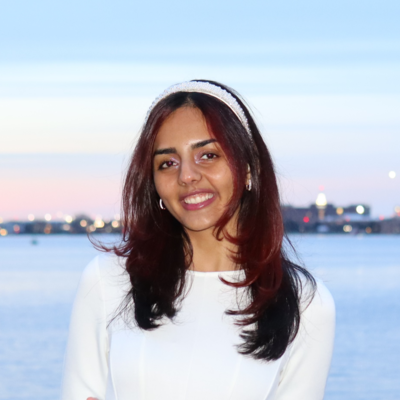
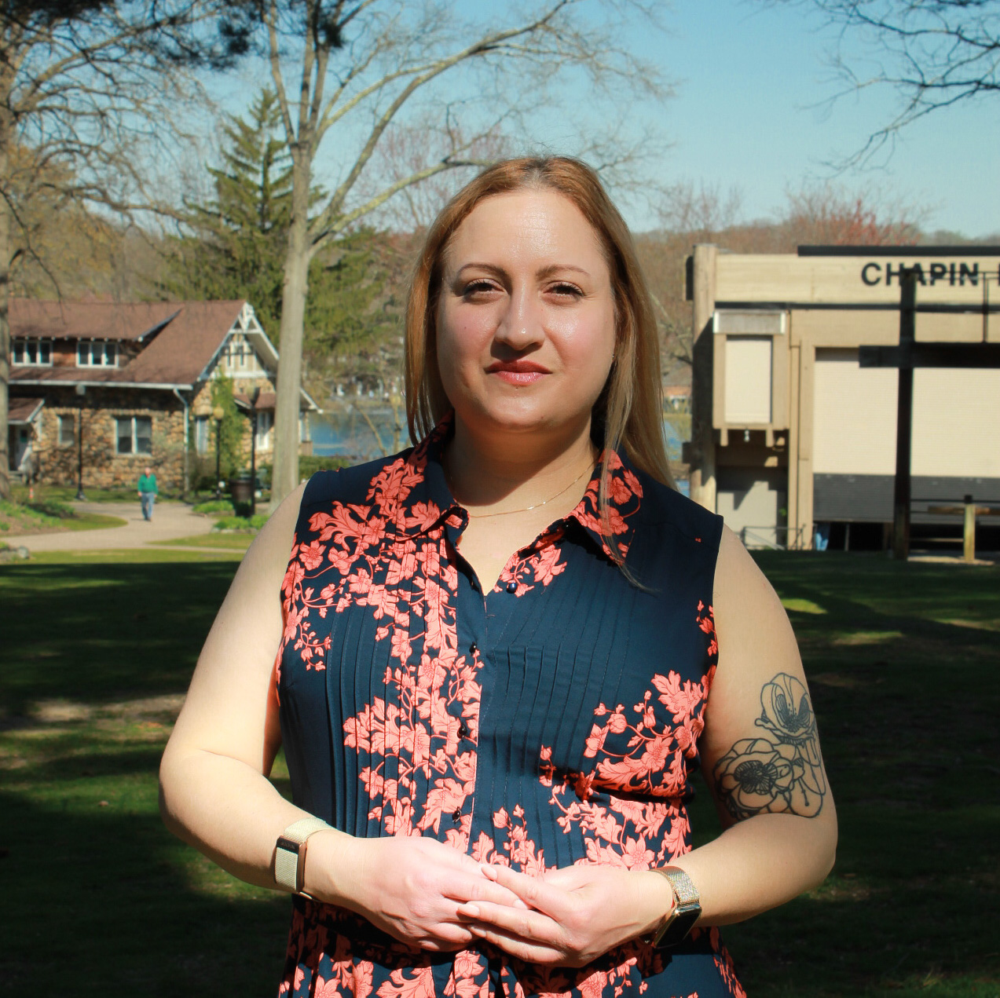
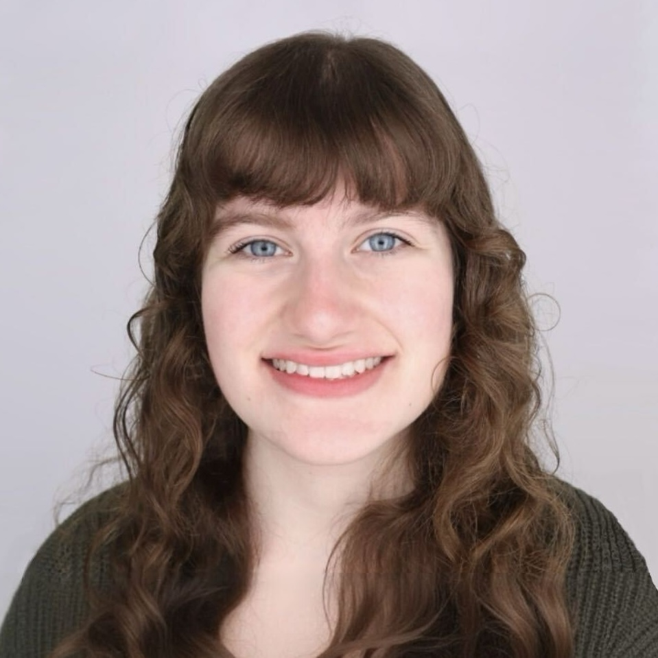
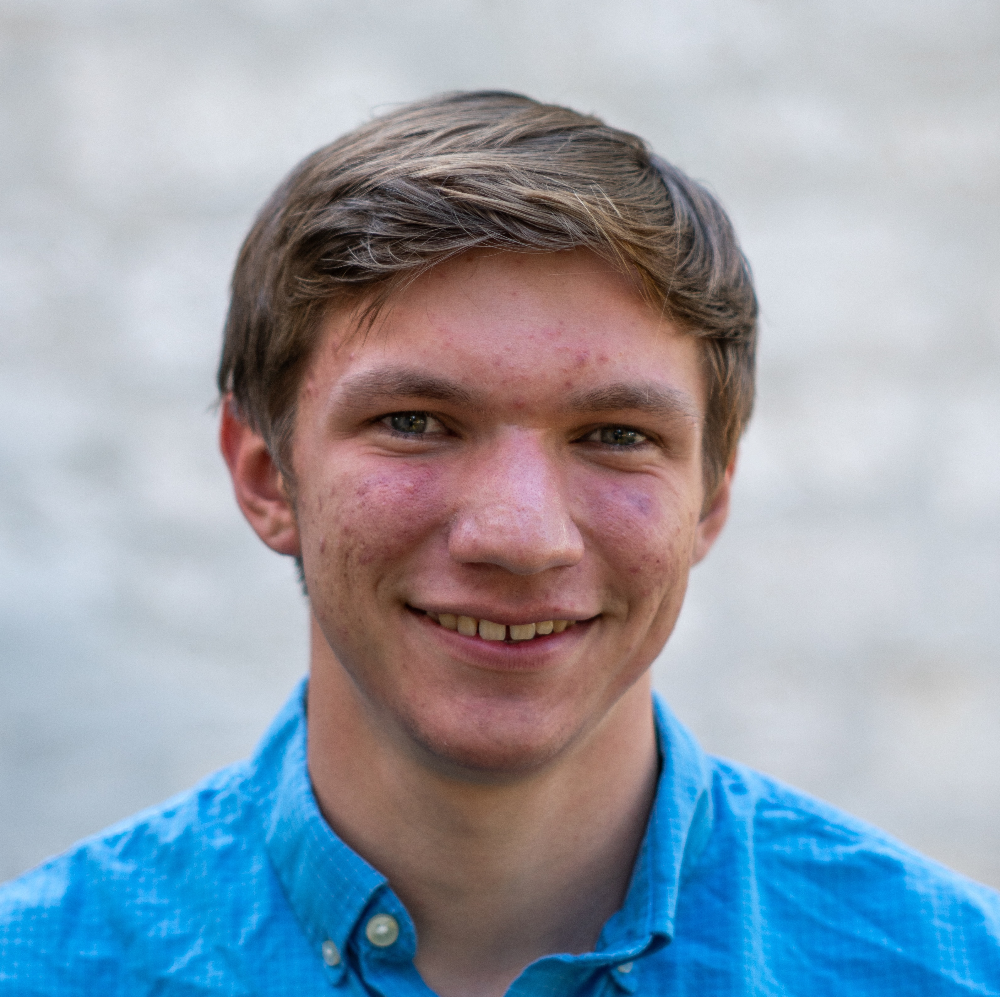
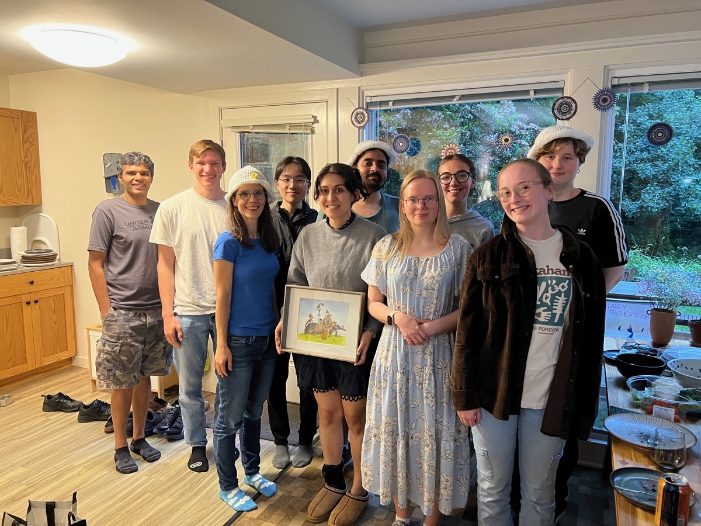

    

        
        

            <strong>Hannah Meyer</strong> 
            Hannah is an Assistant Professor and the lab’s principal
            investigator. She received a B.Sc. and M.Sc. from Heidelberg
            University before she started her Ph.D. in Ewan Birney's research
            group at the European Bioinformatics Institute (EMBL-EBI), University
            of Cambridge. After graduation, Hannah started her independent
            research group at CSHL.
        

    

    

        
        

            <strong>Yong Lin</strong> 
            Yong is a Postdoctoral Fellow. He received a Ph.D. in Immunology
            from Baylor College of Medicine. In the Meyer Lab, he studies how
            genetic polymorphisms influence pediatric T cell development and
            predisposition to immune-mediated diseases in adulthood.
        

    

    

        
        

            <strong>Rishvanth Prabakar</strong> 
        Rish is a postdoctoral fellow. He studies the interaction between T cells
        and epithelial cells in the thymus to understand the process of negative
        selection which helps prevent auto immunity. He was previously trained in
        molecular and computational biology focusing on single cell genomics
        at the University of Southern California.
        

    

    

        
        

            <strong>Todor Cvetanovic</strong> 
            Todor is an immunology novice, a PhD student interested in RNA biology,
            regulation and mechanisms of promiscuous gene expression in the thymus.
            He received his BSc and MSc degrees in Molecular Biology from University
            of Belgrade, Serbia.
        

    

    

        
        

            <strong>Sarah Chapin</strong> 
            Sarah is a Computational Science Developer. She received an A.B. in
            Biomedical Engineering from Harvard University, where she worked on
            genome-wide association studies of infectious diseases. In the Meyer
            lab, she uses spatial transcriptomics to investigate antigen
            presentation in the thymus.
        

    

    

        
        

            <strong>Vasilisa Kovaleva</strong> 
            Vasilisa is a PhD student at CSHL School of Biological Sciences. She received a B.Sc
            from Moscow State University and an M.Sc. from Skoltech University.
            She is interested in molecular mimicry and how it impacts the
            differentiation between self and foreign by adaptive immunity.
            In the Meyer Lab, she studies the cross-reactivity of T-cell
            receptors.
        

    

    

        
        

            <strong>Urja Choudhary</strong> 
            Urja is a Research Technician in the Meyer Laboratory. She received
            her BSc in Biotechnology from the University of Mumbai and her MSc
            in Biotechnology from Northeastern University, Boston. With a
            background in mechano-developmental biology and molecular biology,
            and a keen interest in immunology, she now focuses on human thymic
            epithelial cell development.
        

    

    

        
        

            <strong>Antonia Little</strong> 
            Antonia is the Scientific Administrator for the Meyer Lab. She received
            her B.A. in Psychology from Hunter College. She supports our lab in
            all matters that relate to administration, recruitment, and
            organization.
        

    

    

        
        

            <strong>Emily Goldstein</strong> 
            Emily is a research technician in the Meyer lab. She received a
            B.S. in Biology and a minor in Digital and Data Studies from
            Binghamton University. With a background in cancer research that
            focused on epigenetics and immunology, she now studies human thymic
            epithelial cell development.
        

    

    

        
        

            <strong>Dominic Pruss</strong> 
            Dominic is an undergraduate researcher in the Meyer Laboratory. He is
            currently studying at Baylor University in the Science Research
            Fellows program (Bioinformatics concentration) with a secondary major
            in biochemistry. In the Meyer lab he studies the role of cell type and
            tissue on cellular identity to help understand the identity of
            medullary thymic epithelial cells.
        

    

    

    

    

    <h4>Meyer Lab Alumni</h4>
    

    

        
        

            <strong>Meyer lab 2021</strong> 
        

    

    

        
        

            <strong>Meyer lab 2023</strong> 
        

    

    

        
        

            <strong>Meyer lab 2025</strong> 
        

    

    Check out what our Lab Alumni are up to now: <a href="/alumni/">Meyer Lab Alumni</a>

