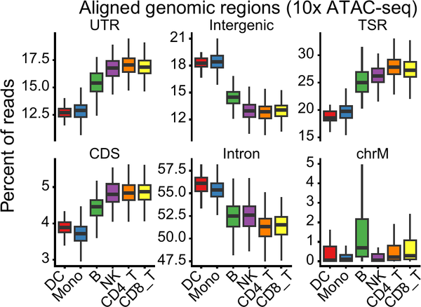
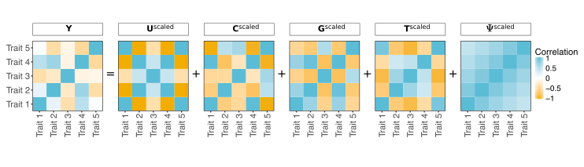
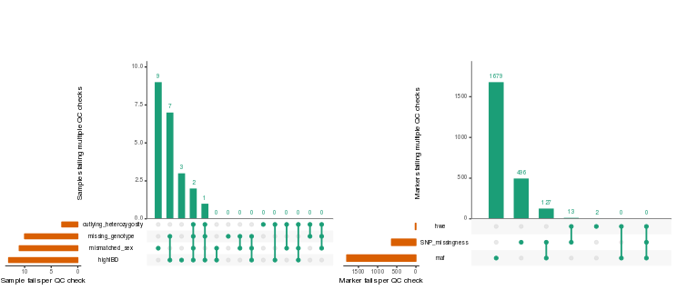
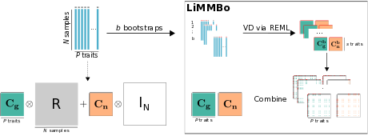

    

        
    

    

        

            <a href="https://github.com/rishvanth-kp/its_a_scam"><strong>its_a_scam</strong></a> 
            its_a_scam - It's a scam To Sell Another Single Cell Analysis
            Method: modular tools for processing and per-cell quality control of
            single cell genomic data, built on the
            <a href="https://github.com/rishvanth-kp/gcatlib">gcat</a> C++ library
            and described in
            <a href="https://doi.org/10.64898/2026.11.03.764034">Prabakar &amp; Meyer, <i>bioRxiv</i> (2026)</a>.
            It works with common open-source tools to generate scRNA-seq and
            scATAC-seq count matrices and computes quality metrics directly from
            alignment files. Documentation is available at
            <a href="https://its-a-scam.readthedocs.io/">its-a-scam.readthedocs.io</a>.
        

    

    

        
    

    

        

            <a href="https://github.com/meyer-lab-cshl/BATMAN/"><strong>BATMAN</strong></a> 
            BATMAN - Bayesian Inference of Activation of TCR by Mutant Antigens:
            python package for predicting TCR activation by mutant peptides
            based on their distances to the TCR's index peptide, described in
            <a href="https://www.cell.com/cell-systems/fulltext/S2405-4712(25)00257-8">Banerjee et al., <i>Cell Systems</i> (2025)</a>.
            BATMAN can be
            used for within-TCR and cross-TCR predictions and in active learning
            mode to design TCR activation assays.
        

    

    

        
    

    

        

            <a href="https://github.com/meyer-lab-cshl/copepodTCR/"><strong>copepodTCR</strong></a> 
            copepodTCR - COmbinatorial PEptide POoling Design for TCR
            specificity: python package and webtool for the design of
            combinatorial peptide pooling schemes for TCR specificity assays, described in
            <a href="https://www.biorxiv.org/content/10.1101/2023.11.28.569052v2">Kovaleva et al., <i>bioRxiv</i> (2025)</a>.
            CopepodTCR guides the user through all stages of the experimental
            design and interpretation, including pooling schemes, peptide mixing
            layouts and results evaluation.
        

    

    

        
    

    

        

            <a href="https://codepub.readthedocs.io/en/latest/"><strong>codePUB</strong></a> 
            Python tool to generate balanced constant-weight Gray codes for detecting
            consecutive positive items in the efficient construction of
            combinatorial pooling schemes, described in
            <a href="https://academic.oup.com/bioinformatics/advance-article/doi/10.1093/bioinformatics/btaf611/8054562">He, Kovaleva et al., <i>Bioinformatics</i> (2025)</a>.
        

    

    

        
    

    

        

            <a href="https://github.com/meyer-lab-cshl/PhenotypeSimulator"><strong>PhenotypeSimulator</strong></a> 
            R/CRAN framework for simulating genotype to phenotype relationships, described in
            <a href="https://doi.org/10.1093/bioinformatics/bty197">Meyer &amp; Birney, <i>Bioinformatics</i> (2018)</a>.
            It can
            model multiple traits with multiple underlying genetic loci as well as complex
            covariate and observational noise structure. This package has been designed
            to work with many common genetic tools both for input and
            output.
        

    

    

        
    

    

        

            <a href="https://meyer-lab-cshl.github.io/plinkQC/"><strong>plinkQC</strong></a> 
            R/CRAN package for common genotype quality control steps, described in
            <a href="https://academic.oup.com/bioinformatics/article/42/9/btag612/8761982">Syed et al., <i>Bioinformatics</i> (2026)</a>.
            It provides
            an easily applicable workflow from per-individual and per-marker quality
            control to the generation of the  new, quality-controlled dataset.
            The outcomes of each quality control step are summarised in a quality
            control report.
        

    

    

        
    

    

        

            <a href="https://github.com/HannahVMeyer/LiMMBo"><strong>LiMMBo</strong></a> 
            Python module for computationally efficient joint genetic analysis of
            high-dimensional phenotypes, using linear mixed models with bootstrapping, described in
            <a href="https://www.biorxiv.org/content/early/2018/01/30/255497">Meyer et al., <i>bioRxiv</i> (2018)</a>.
        

    

